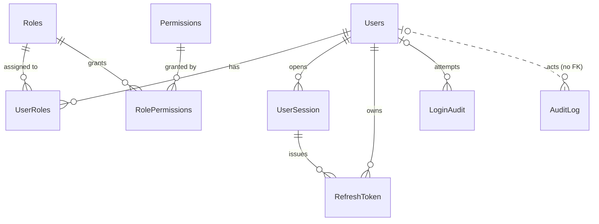

# ER model

## Tables

| Table | Purpose | Key points |
|---|---|---|
| **Users** | Accounts | `PasswordHash` (BCrypt). Lockout state is `FailedLoginCount` and `LockoutUntil`. Also has `LastLoginOn`, `MustChangePassword` and `PasswordChangedOn`. Soft delete. `ConcurrencyStamp` (V14) for optimistic concurrency on administrative edits; `RowVersion` also changes on every login, so it isn't used for that. A username can't contain `@`. |
| **Roles** | Named groups of permissions | `IsSystem = 1` for the seeded Admin and User roles, which can't be renamed, deactivated or deleted. Soft delete. `RowVersion`. |
| **Permissions** | Fine-grained rights checked by `@PreAuthorize` | `Code` is UPPER_SNAKE_CASE and unique, e.g. `USER_VIEW`. `Module` groups them in the UI. Seeded, no soft delete. |
| **UserRoles** | User ↔ Role | Unique on (UserId, RoleId). Revoking deletes the row. |
| **RolePermissions** | Role ↔ Permission | Unique on (RoleId, PermissionId). Revoking deletes the row. |
| **UserSession** | Server-side session per login | `Id` is a random GUID (the JWT `sid` claim). Tracks absolute `ExpiresOn`, `LastActivityOn` for the idle timeout, and the revocation flags. |
| **RefreshToken** | Rotating refresh tokens | Stores only `TokenHash` (lowercase hex SHA-256). `ReplacedByTokenHash` links a rotation chain for reuse detection. A token never outlives its session. |
| **LoginAudit** | Every login attempt | `UserId` is NULL when the identifier is unknown. |
| **AuditLog** | Data changes | `OldValues` and `NewValues` are JSON snapshots (never a password hash). `ActorUserId` has no FK. |

## Conventions

- Common columns: `Id BIGINT IDENTITY`, `CreatedBy`, `CreatedOn`, `ModifiedBy`, `ModifiedOn`, `IsActive`, `IsDeleted`, used where relevant. Link and log tables carry only the created columns.
- All times are UTC `DATETIME2(3)`.
- `CreatedBy`, `ModifiedBy` and `ActorUserId` hold a user id but have no FK. This avoids self-reference cycles and allows NULL for system or seed actions.
- **Soft delete:** set `IsDeleted = 1` and `IsActive = 0`. Username, email and role-name uniqueness uses filtered indexes `WHERE IsDeleted = 0`, so names can be reused after a delete.
- **Effective permissions:** permission → role → user. Only an active, non-deleted user, an active, non-deleted role and an active permission count. See `fn_GetUserPermissions`.
- **Safeguards:**
  - The last active Admin can't be deactivated, deleted or lose the Admin role (50004).
  - `ROLE_MANAGE` can't be revoked from Admin (50502).
  - A user can't deactivate or delete themselves (50304).
- `UserSession` is clustered on `CreatedOn` with a nonclustered GUID primary key, which avoids page splits from random GUIDs.
- Database option: `READ_COMMITTED_SNAPSHOT ON` (set in `scripts/create-database.sql`).
